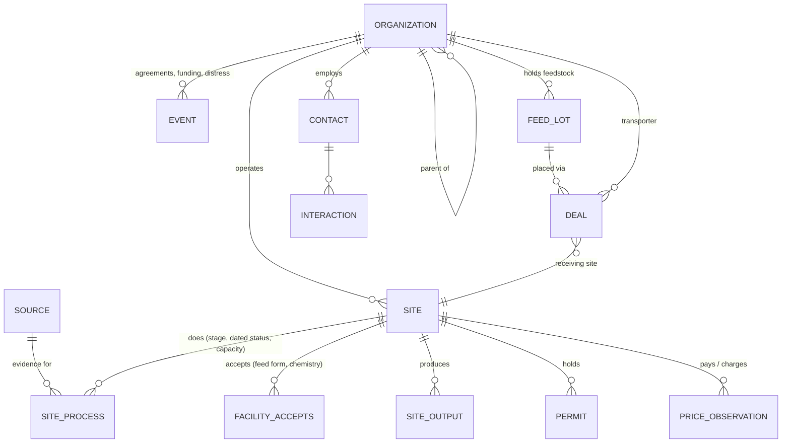

# battery_intel

A private intelligence and deal system for **US lithium-ion (EV) battery resource recovery**.

**First goal:** a complete, sourced map of the US **pre-processors** (discharge, dismantling, shredding to black mass) and **refiners** (hydrometallurgical, pyrometallurgical, direct recycling): what each site does, its dated status and capacity, and what feed it accepts. This is the base for **feedstock placement**: brokering manufacturing scrap, end-of-life packs, modules, cells and black mass to the right processor.

**Principle:** every fact has a source and a date; unknown stays blank; desk research is never treated as confirmation; no deal advances without passing the deal gate.

## Contents

| Item | Where |
|---|---|
| **Seed map (first research pass) and report** | [research/seed_report.md](research/seed_report.md) · workbook [research/battery_intel_seed_2026-11.xlsx](research/battery_intel_seed_2026-11.xlsx) |
| Blank workbook template | [templates/battery_intel_v1.xlsx](templates/battery_intel_v1.xlsx) |
| Data checker + deal gate | [tools/check_workbook.py](tools/check_workbook.py) |
| Research importer (JSON → workbook) | [tools/import_research.py](tools/import_research.py) · format: [research/FORMAT.md](research/FORMAT.md) |
| Workbook generator (single source of truth) | [templates/build_template.py](templates/build_template.py) |
| Database schema (draft) | [sql/0001_schema.sql](sql/0001_schema.sql) |
| Tests | [tests/](tests/) |
| Plan · research method · data quality · regulatory checklist · decisions | [docs/](docs/) |

## Everyday commands

```bash
python tools/check_workbook.py data/battery_intel.xlsx                    # check; exit code 1 = errors
python tools/check_workbook.py data/battery_intel.xlsx --audit-sample 10  # monthly spot-check list
python tools/import_research.py out.xlsx research/raw/*.json              # load research JSON
python -m unittest discover -s tests                                      # run the tests
python templates/build_template.py                                        # rebuild the blank template
```

Needs Python 3.10+ and `openpyxl` (`pip install openpyxl`).

## Data model



Framework adapted from [waste_model](https://github.com/oscarcastellas/waste_model).
